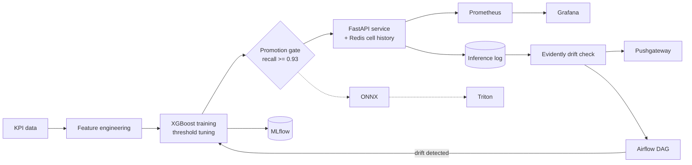

# Telecom Network Anomaly Detection System

[](https://github.com/mohamed-amin-ai/mlops-anomaly/actions/workflows/ci.yml)
[](https://github.com/mohamed-amin-ai/mlops-anomaly/actions/workflows/evaluation.yml)

An end-to-end machine-learning system that detects faults in telecom network KPIs in real time. A gradient-boosted classifier is served through a FastAPI service and wrapped in a full MLOps layer: experiment tracking, data versioning, CI/CD, monitoring, drift detection, scheduled retraining and Kubernetes deployment.

<p align="center"></p>

*Held-out test set (last 20% of the time window, never seen in training), real XGBoost, measured in CI.*

## Contents

[Problem](#problem) · [Architecture](#architecture) · [Quickstart](#quickstart) · [Docker](#running-with-docker) · [Features](#feature-engineering) · [Model](#model-details) · [API](#api) · [Results](#results) · [MLOps](#mlops) · [Repository layout](#repository-layout) · [Tech stack](#tech-stack)

---

## Problem

Telecom networks generate thousands of KPI readings per minute across hundreds of cell towers. Finding fault conditions (congestion, hardware degradation, interference) by hand is slow and reactive. This system flags anomalies automatically so a network operations centre (NOC) can act before users are affected.

Monitored KPIs:

| KPI | Unit | What it signals |
|---|---|---|
| `latency_ms` | ms | Congestion, backhaul issues |
| `throughput_mbps` | Mbps | Hardware faults, interference |
| `packet_loss_pct` | % | Link instability, interference |
| `sinr_db` | dB | Signal quality, interference |
| `connected_users` | count | Load-related anomalies |

## Architecture



---

## Quickstart

Developed and tested on Python 3.12.

```bash
pip install -r requirements.txt
python data/generate_data.py      # generate the KPI dataset
python data/features.py           # time-series features
python models/train.py            # train, tune threshold, save model
uvicorn api.main:app --reload --port 8000
```

Interactive API docs: <http://localhost:8000/docs>

**First request.** A new cell has no history, so the first call for any `cell_id` intentionally returns `425 Too Early` rather than guessing from a mostly empty feature vector:

```bash
curl -X POST http://localhost:8000/predict \
  -H "Content-Type: application/json" \
  -d '{"cell_id": "CELL_001", "latency_ms": 145.5, "throughput_mbps": 12.3,
       "packet_loss_pct": 8.7, "sinr_db": 4.2, "connected_users": 87}'
```

Send about 20 more readings for the same `cell_id`, in chronological order, and the API returns real predictions. If you already have the 68 pre-computed features, pass them in the `features` field and skip the warm-up.

Common commands are in the `Makefile` (`make test`, `make pipeline`, `make serve`, `make docker-up`, `make drift-check`, `make onnx-convert`).

## Running with Docker

```bash
docker compose up --build          # API + Prometheus + Pushgateway + Grafana
```

or the API alone:

```bash
docker build -t telecom-anomaly-detection .
docker run -p 8000:8000 telecom-anomaly-detection
```

The image runs as a non-root user with a `HEALTHCHECK` on `/health`. Model artifacts are baked in at build time, so rebuild after retraining. Kubernetes deployment (kustomize, HPA, monitoring) is documented in [k8s/README.md](k8s/README.md).

---

## Feature Engineering

68 features are computed per cell tower from 5 KPIs:

| Feature group | Detail | Count |
|---|---|---|
| Raw KPI values | current reading | 5 |
| Lag features | t-1, t-2, t-4, t-8 (15 min to 2 h ago) | 20 |
| Rolling mean | 1 h and 4 h windows | 10 |
| Rolling std | 1 h and 4 h windows (variance bursts) | 10 |
| Rolling min / max | 1 h window | 10 |
| Z-score | deviation from the 4 h rolling mean | 5 |
| Rate of change | `(t - t-1) / t-1`, detects sudden jumps | 5 |
| Time features | hour of day, day of week, is_weekend | 3 |
| **Total** | | **68** |

## Model Details

| Parameter | Value |
|---|---|
| Algorithm | XGBoost (gradient boosted trees) |
| Trees | up to 300, with early stopping |
| Max depth | 6 |
| Learning rate | 0.05 |
| Class imbalance | `scale_pos_weight` |
| Threshold | tuned on the validation set for a 94.5% recall target, read from the real validation curve |
| Split | time-based 80/20, no shuffle |
| Promotion gate | a new model must reach at least 93% recall on the test set |

**Why XGBoost.** It handles tabular time-series features well, is robust to feature scale and missing values, scores in well under a millisecond, and provides feature importances that NOC teams can inspect.

**Why tune the threshold.** The default 0.5 threshold maximises accuracy, not recall. In fault detection a missed fault costs far more than a false alarm, so the threshold makes that trade-off explicit.

## API

| Method | Endpoint | Description |
|---|---|---|
| GET | `/health` | Liveness check |
| GET | `/model/info` | Model metrics and threshold |
| POST | `/predict` | Single snapshot prediction |
| POST | `/predict/batch` | Batch of up to 500 snapshots |
| GET | `/metrics` | Prometheus metrics |

Authentication is optional: set `API_KEYS="key1,key2"` and the prediction routes and `/model/info` require an `X-API-Key` header. If Redis is unavailable, raw readings return `503` while pre-computed requests, `/health` and `/metrics` keep working.

---

## Results

| Metric | Value |
|---|---|
| Recall | **95.0%**: catches 95 of every 100 faults |
| Precision | **80.4%**: about 1 in 5 alerts is a false alarm |
| F1 score | **0.871** |

*Held-out test set, never seen in training. The threshold targets 94.5% recall on the validation set.*

---

## MLOps

| Capability | Tool |
|---|---|
| Experiment tracking and model registry | **MLflow** |
| Data, model and pipeline versioning | **DVC** |
| CI/CD (lint, tests, pipeline run, image build and push) | **GitHub Actions** to GHCR |
| Metrics and dashboards | **Prometheus**, **Grafana** (2 dashboards) |
| Data and prediction drift detection | **Evidently** with Pushgateway |
| Scheduled drift check, retrain and promote | **Airflow** |
| Portable, high-throughput serving | **ONNX**, **Triton** |
| Container orchestration | **Docker**, **Kubernetes** (kustomize), **Redis** (shared state) |

### Operational results

| Area | Result |
|---|---|
| Automated tests | **156** passing |
| Serving (one process, with Redis) | **292 req/s**, p95 latency **19 ms**, **237 MiB** peak memory after optimisation, against 24 req/s and 229 ms before (same load, same CI runner; run-to-run spread about 2x) |
| Horizontal scaling | 2-6 API replicas share per-cell history; a cell is ready after exactly **20** readings regardless of which replica receives them; the autoscaler (70% CPU target) decided to scale out within **30 s** and asked for the 6-replica maximum (measured on kind) |
| Resilience | Redis outage: raw readings return `503`, pre-computed requests, `/health` and `/metrics` keep serving; recovers without a restart |
| Drift detection (Evidently 0.4.33, run in CI) | held-out traffic flags **0 / 68** features; a latency-only 2x shift flags **11 / 68**; a multi-KPI congestion incident flags **55 / 68** (81%) and sets the dataset-drift flag |
| Security | optional API-key auth; non-root, read-only containers; optional HTTPS Ingress |

### Impact by tool

What each tool contributed, as measured in CI on the real libraries (single runs on shared runners, ~2× run-to-run noise).

| Tool | Impact (measured) |
|---|---|
| **MLflow** | 3 tracked runs, 3 registered versions, model round-trip with zero prediction difference. The promotion gate (min recall 0.93) promoted v3 and would block seeds 4 and 7, which fall below it. |
| **DVC** | A second `dvc repro` with no changes skips all three stages; changing a training parameter re-runs only `train` and skips data generation and feature engineering, so retraining is reproducible and incremental. |
| **Evidently** | Flags drift only when it should: healthy hold-out 0/68 features, latency-only shift 11/68, congestion incident 55/68. Airflow reads this as `data_drift_share` and retrains on it. |
| **Airflow** | Healthy run takes the skip path (3 tasks); a drifted run goes drift → retrain → promote (6 tasks) and pushes `data_drift_share` 0.82 to Pushgateway. |
| **FastAPI + API-key auth** | Scores match the offline model (max difference 5e-5); auth checks pass. After optimisation one process serves 292 req/s at p95 19 ms using 4.3 ms of CPU per request (was 24 req/s, p95 229 ms, 51.5 ms), about 237 MiB. |
| **Feature path optimisation** | Per-request feature computation went from 23.8 ms (pandas pipeline) to 0.64 ms (NumPy), about 37x, with outputs equal to the original to 1e-9 on thousands of checked cases; edge cases fall back to the original code. This one change is most of the throughput gain. |
| **Redis** | Holds the inference log for drift checks: ~5 MiB per 1.2k rows (~85 MiB at the 20k-row cap); peak 91 MiB and 101m CPU at 496 req/s. |
| **ONNX** | Matches XGBoost to 1e-7; single-row prediction 0.012 ms vs 0.43 ms for XGBoost. As an opt-in scorer in the API (`SCORER=onnx`) the whole service reaches 330 req/s at p95 17 ms (292 req/s and 19 ms with XGBoost). |
| **Triton (CPU)** | Matches XGBoost to 1e-7 with 100% decision agreement; ~6 ms per single row over HTTP (network included). Batches capped at 64, inputs must be scaled. |
| **Docker** | The API image is **481 MiB**, down from 3,006 MiB (the image built from the full `requirements.txt`, measured in CI): installing runtime dependencies only took it to 886 MiB, and moving Evidently and its dependencies (plotly, statsmodels, pyarrow) into a separate `drift` image used by the drift CronJob took it to 481 MiB. Runs as uid 1000, passes its health check. |
| **Model size** | Fewer or shallower trees were tested at the same recall target. None beat the shipped depth-6 model on F1 (0.871); depth 4 with 150 trees is 3.7x smaller (308 KiB vs 1,127 KiB) but loses about 3 points of precision, and single-row latency does not change (about 0.4 ms), so the shipped model stays. |
| **Kubernetes + HPA** | Scale-out starts 30 s after load begins and requests the 6-replica maximum; with the optimised API the cluster served 496 req/s at p95 91 ms with zero errors. Scale-in starts about 205 s after load ends and reaches the 2-replica minimum after 388 s. Size the node pool for `maxReplicas × 500m` (one pod stayed Pending on a 4-vCPU runner). |
| **Prometheus / Grafana / Pushgateway** | Light: peaks of 5m CPU / 35 MiB, 3m / 67 MiB and 1m / 16 MiB. Resource values and the Prometheus volume (2 Gi) were set from these. |
| **CI/CD (GitHub Actions)** | Exposed the real-library bugs (version pins, converter errors, image loading, Airflow image conflicts) and publishes the measured results to branches so they are reproducible. |

The drift job peaked at 999m CPU and 284 MiB and finished in 22 s.

Not measured yet: Triton on GPU.

*All figures were measured in CI on the real libraries (XGBoost 2.1.4, MLflow, DVC, Evidently 0.4.33, Airflow, ONNX Runtime, Triton) on the project's KPI dataset. Per-tool report: the `evaluation-results` branch. Detailed tables: [EXPERIMENTS.md](EXPERIMENTS.md).*

---

## Repository layout

```
.
├── data/            KPI data generator and feature engineering
├── models/          training, threshold tuning, promotion gate, ONNX export
├── api/             FastAPI service, API-key auth, per-cell history, Redis state, metrics
├── monitoring/      Evidently drift check -> Pushgateway
├── airflow/dags/    scheduled drift check -> retrain -> promote
├── k8s/             kustomize manifests (HPA, Redis, Prometheus, Grafana, drift CronJob)
├── triton_model_repository/   Triton config for the ONNX model
├── prometheus/ grafana/       docker-compose monitoring configuration
├── scripts/         measurement and study scripts used by CI
├── tests/           156 tests
├── .github/workflows/         ci.yml, evaluation.yml
├── params.yaml  dvc.yaml  Makefile
└── Dockerfile  Dockerfile.airflow  docker-compose*.yml  requirements*.txt
```

## Tech Stack

`Python` · `XGBoost` · `scikit-learn` · `Pandas` · `NumPy` · `FastAPI` · `Pydantic` · `Uvicorn` · `Docker` · `MLflow` · `DVC` · `GitHub Actions` · `Prometheus` · `Grafana` · `Evidently` · `Airflow` · `ONNX` · `Triton` · `Kubernetes` · `Redis`
